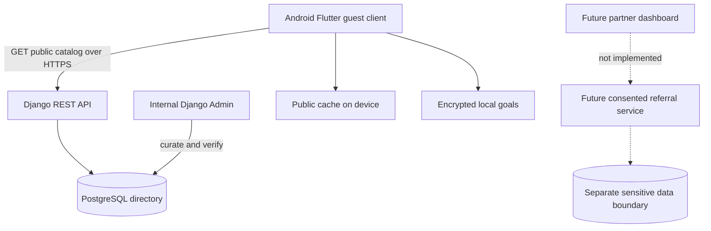

# Technical architecture and trust boundaries

## Decisions

- Flutter Material 3 frontend, Android first.
- Django 5.2 LTS + Django REST Framework.
- Local debug DB SQLite; PostgreSQL production DB via `DATABASE_URL`.
- Staff uses Django Admin for publishing; public API only returns verified and active records.
- No authentication or personal server-side data in v0.1. Staff Django Admin authentication only.
- Public cache in `shared_preferences`. Personal goals encrypted using OS-protected storage via `flutter_secure_storage`. Android backup behaviour requires pre-release review.
- No background GPS, SMS, WhatsApp, contacts or accessibility service permissions.

## Application modules

- `directory`: vetted public listings and resources.
- `mobile/src/data/catalog_repository.dart`: remote fetch, public offline cache.
- `mobile/src/data/local_store.dart`: on-device bookmarks and goals.
- `mobile/src/screens`: Home, Explore, Support, My Plan, Settings.

## Publication invariant

For every public record: `is_active=True` and `is_verified=True`. Opportunity deadline must be null or today/future (server local date). Admin publication should eventually require `source_url` plus `last_verified_at` and periodic re-review. The current flags are necessary but NOT sufficient assurance of real-world truth.

## Threats to revisit before beta

- Stale cached listings after admin revocation; offline list must have finite TTL, visible staleness state, and source recheck. Consider emergency blacklist sync for known scams.
- External URLs and telephone link safety; validate `https` and approved official domains where possible, and don't render HTML from descriptions.
- Django Admin exposed publicly; use MFA, rate limits, audit, separate internal address/VPN, and least privilege.
- Unencrypted SQLite and browser/client analytics; no sensitive notes or medical records in general-purpose stores.
- Secure storage backup restore inconsistency, device sharing, screen previews, clipboard leakage.
- Sensitive data segregation and processing contracts prior to any referral feature.

## Backend deployment rules

- Secret key, allowed hosts and DATABASE_URL explicitly configured. DEBUG false. TLS, secure cookies, HSTS and monitoring.
- Lock down Admin; backups encrypted, tested restore, scoped DB access.
- Logging: no tokens, medical details, goals, phone numbers or case notes.
- Recheck CORS/CSRF behaviour for separate admin dashboard deployment.
- Verify Django `check --deploy`, dependency scans and migrations in CI before launch.
