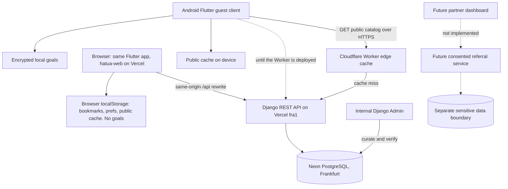

# Technical architecture and trust boundaries

## Decisions

- Flutter Material 3 frontend, Android first.
- Django 5.2 LTS + Django REST Framework.
- Local debug DB SQLite; PostgreSQL production DB via `DATABASE_URL`.
- Staff uses Django Admin for publishing; public API only returns verified and active records.
- No authentication or personal server-side data in v0.1. Staff Django Admin authentication only.
- Public cache in `shared_preferences` (24 h, then deleted). Personal goals encrypted with an AES-256-GCM key in the Android Keystore (`GoalVault.kt`, no user-auth prompt); only ciphertext is stored, in app-private preferences. If the Keystore fails, only My Plan is disabled. Android backup and device transfer disabled for all app data.
- No background GPS, SMS, WhatsApp, contacts or accessibility service permissions. The only permission is `INTERNET`.
- Release builds refuse non-https API URLs; cleartext is allowed only in debug builds and only to emulator/localhost hosts.
- Web build (`mobile/web/`, Vercel project `hatua-web`): same code; `CatalogRepository` calls the page's own origin and `mobile/vercel.json` proxies `/api/*` to the API. `GoalVault.isSupported` is false on the web, so My Plan is off there. CanvasKit and fonts self-hosted; strict CSP.
- UI strings via Flutter gen-l10n (`mobile/lib/l10n`), English template plus draft Kiswahili.

## Application modules

- `directory`: vetted public listings and resources.
- `directory/counties.py` ↔ `mobile/lib/src/data/counties.dart`: shared county list.
- `mobile/lib/src/data/catalog_repository.dart`: remote fetch, public offline cache, network/cache/unavailable states.
- `mobile/lib/src/data/local_store.dart`: on-device bookmarks, county/language prefs and encrypted goals.
- `mobile/lib/src/widgets/directory_widgets.dart`: status banner, county picker, chips, link/tel sanitising.
- `mobile/lib/src/screens`: Home, Explore, Support, My Plan, Settings (tabs built on first visit).

## Publication invariant

For every public record: `is_active=True`, `is_verified=True`, and `last_verified_at` within `HATUA_VERIFICATION_MAX_AGE_DAYS` (default 90) and not in the future. Opportunity deadline must be null or today/future (server local date). Admin forms require `source_url` and `last_verified_at` before verification and record the reviewer. These checks are necessary but NOT sufficient assurance of real-world truth.

## Threats to revisit before beta

- Stale cached listings after admin revocation: mitigated by the 24 h TTL with deletion and a visible save time. A revoked listing can still show offline for up to 24 h; consider an emergency blocklist sync for known scams.
- External URLs and telephone link safety; validate `https` and approved official domains where possible, and don't render HTML from descriptions.
- Django Admin exposed publicly; use MFA, rate limits, audit, separate internal address/VPN, and least privilege.
- Unencrypted SQLite and browser/client analytics; no sensitive notes or medical records in general-purpose stores.
- Device sharing, app-switcher screen previews, clipboard leakage. (Backup-restore inconsistency mitigated by disabling backup.)
- Sensitive data segregation and processing contracts prior to any referral feature.

## Backend deployment rules

- Secret key, allowed hosts and DATABASE_URL explicitly configured. DEBUG false. TLS, secure cookies, HSTS and monitoring.
- Lock down Admin; backups encrypted, tested restore, scoped DB access.
- Logging: no tokens, medical details, goals, phone numbers or case notes.
- Recheck CORS/CSRF behaviour for separate admin dashboard deployment.
- Verify Django `check --deploy`, dependency scans and migrations in CI before launch.
